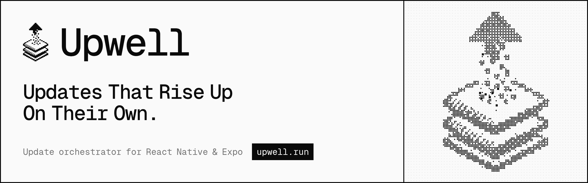

<a href="https://upwell.run">
  <picture>
    <source media="(prefers-color-scheme: dark)" srcset="apps/landing/public/brand/banner-dark.png">
    
  </picture>
</a>

# Upwell platform

The hosted side of [Upwell](https://github.com/updateswell/upwell), the update orchestrator for
React Native and Expo: the website, and later the API that hosts policies and the dashboard.

The library itself (the `upwell` SDK, `@upwell/core`, the CLI and the docs) lives in
[`updateswell/upwell`](https://github.com/updateswell/upwell). Upwell works without this
platform: any URL or custom source can serve the policy.

| App                            | Serves                             | Status  |
| ------------------------------ | ---------------------------------- | ------- |
| [`apps/landing`](apps/landing) | [upwell.run](https://upwell.run)   | Live    |
| `apps/api`                     | `api.upwell.run`, `cdn.upwell.run` | Planned |
| `apps/dashboard`               | `app.upwell.run`                   | Planned |

```sh
pnpm install
pnpm dev         # the landing at http://localhost:3000
pnpm typecheck
pnpm build
```

Brand and design system: [`BRAND.md`](BRAND.md). Plans: [`docs/plans/`](docs/plans/README.md).

## License

[MIT](LICENSE)
